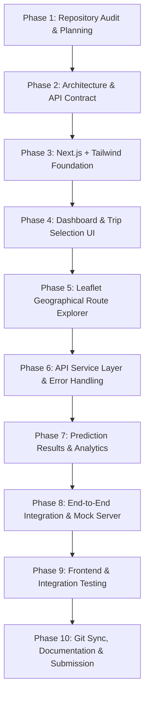

# PathSnap — Phase 1: Repository Audit & Implementation Master Plan

**Project:** PathSnap – Distributed Map-Matching & Route Reconstruction  
**Course:** UE24CS352A Machine Learning Hackathon, PES University  
**Role:** Frontend Architect, Technical Project Lead & DevOps Engineer  
**Division of Responsibility:**
- **Laptop 1 (Teammate):** XGBoost model, preprocessing, candidate generation, HMM/Viterbi route reconstruction, internal server-side ground truth evaluation, FastAPI backend on `0.0.0.0:8000`.
- **Laptop 2 (Self/User):** Complete Next.js frontend, dark analytics UI/UX, Leaflet interactive geospatial map, centralized API service layer, two-laptop hotspot networking, frontend testing, Git coordination, and documentation.

---

## 1. Repository & Asset Audit

| Resource | Location / Status | Findings |
|---|---|---|
| **GitHub Repo** | `https://github.com/shibishetty77/ML-HACKATHON.git` | Cloned at `/Users/sandeeph/Desktop/ML_Lab/ML-HACKATHON`. Remote is currently clean/empty. |
| **Hackathon PDFs** | `ML-HACKATHON/*.pdf` (5 documents) | Analyzed: Mandates two-laptop deployment, 5 compared models, 10 reserved evaluator trips, zero ground truth leakage to UI, and live API logs on Laptop 1. |
| **Model 1: Random Forest** | `Random Forest/Random Forest.ipynb` | 100% completed & executed (Macro F1 = 0.8842, Top-1 Acc = 81.99%, Route Continuity = 90.07%). |
| **Model 2: XGBoost (Final)** | `~/Downloads/XGBoost_Training.ipynb` | Owned by teammate. Artifacts saved under `outputs/xgboost/` (`xgboost_model.json`, `feature_columns.json`, `xgb_config.json`). |
| **Model 3: KNN** | `~/Downloads/PathSnap_KNN_Model.ipynb` | Present in team materials. |
| **Model 4: MLP** | `~/Downloads/PathSnap_MLP_Training.ipynb` | Present in team materials. |
| **Model 5: SVM** | `~/Downloads/SVM_Model.ipynb` | Present in team materials. |
| **Raw & Processed Data** | `data/raw/` & `data/processed/` | 80 training trips, 10 student-test trips. 10 evaluator trips reserved on Laptop 1. |
| **Frontend Application** | Missing | To be created under `ML-HACKATHON/frontend/`. |
| **API Contract & Network Docs**| Missing | To be created under `ML-HACKATHON/docs/`. |

---

## 2. Technical Stack Specification

- **Framework:** Next.js 15+ (App Router)
- **Language:** TypeScript 5+ (Strict mode, zero `any`)
- **Styling:** Tailwind CSS 3+ with a custom dark geospatial analytics palette (Deep navy `#0b0f19`, slate cards `#111827`, border accents `#1f2937`, brand cyan `#06b6d4`, electric blue `#3b82f6`, emerald `#10b981`)
- **Icons:** Lucide React
- **Geographical Visualisation:** Leaflet & React-Leaflet (Interactive map with custom dark tile layer, GPS observation point markers, predicted road segment polylines, bounding-box auto-fit, layer controls, and legend)
- **Charts & Statistics:** Recharts (Candidate probability distributions, speed profiles, metric comparisons)
- **Testing:** Vitest / React Testing Library + Playwright E2E
- **Networking:** Fetch API with AbortController timeout, automatic retries, and dynamic `NEXT_PUBLIC_API_BASE_URL`

---

## 3. Strict Boundary & Security Rules

1. **Zero Ground Truth Exposure:** Evaluator reference route labels must NEVER be sent in API responses or rendered on Laptop 2.
2. **Server-Side Metric Calculation:** Top-1 Accuracy, Precision, Recall, Macro F1, Route Continuity, and Candidate Miss Rate are calculated internally on Laptop 1 and served via the JSON response.
3. **Dynamic Host Discovery:** The backend binds to `0.0.0.0:8000`. The frontend discovers or configures the backend IP at runtime via an intuitive connection modal/setting bar and `.env.local`.
4. **Git Isolation:** Teammate commits `backend/` and `models/`. We commit `frontend/`, `docs/`, tests, and root configuration.

---

## 4. Phased Implementation Roadmap

